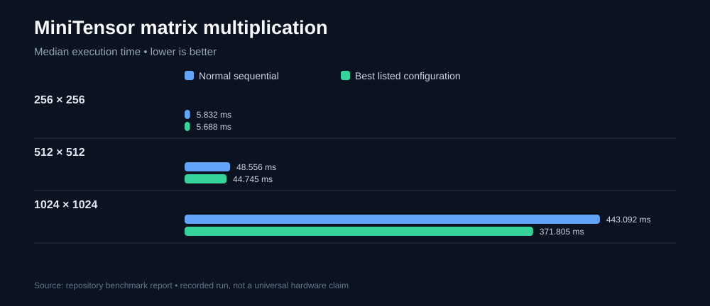
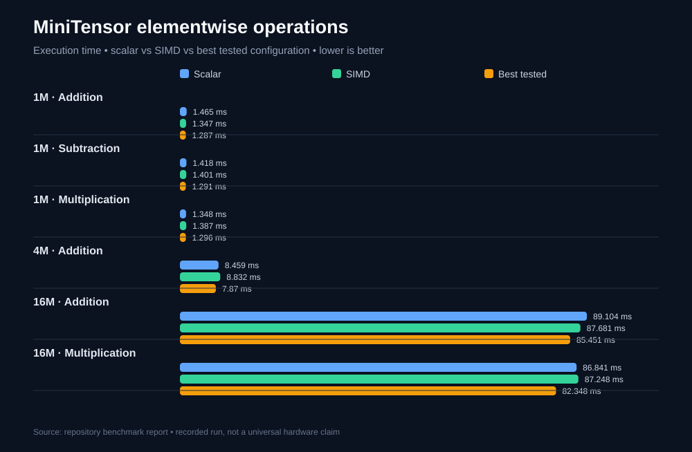
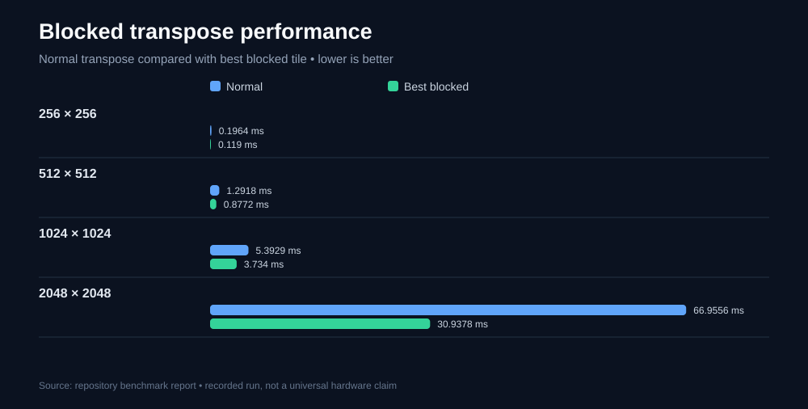
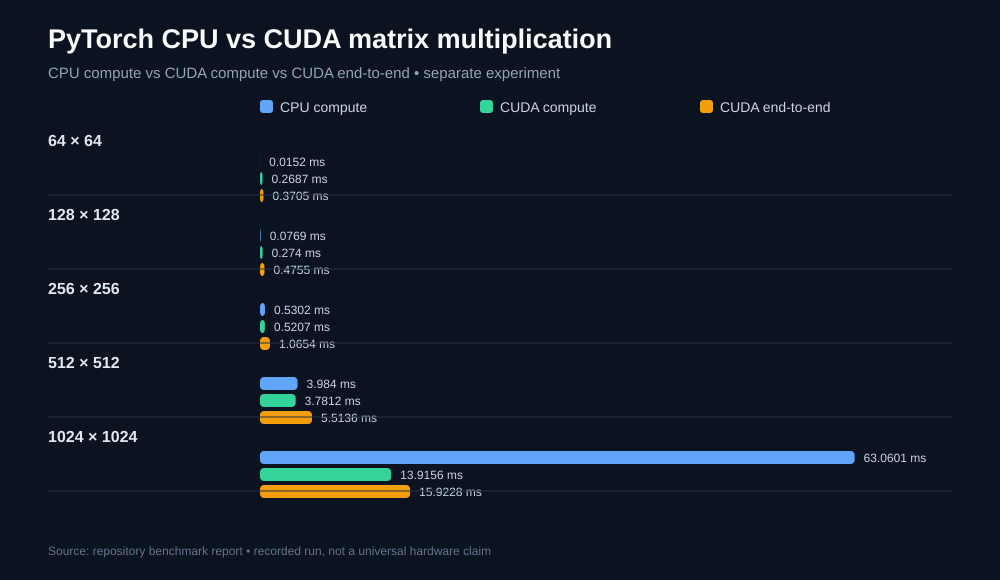
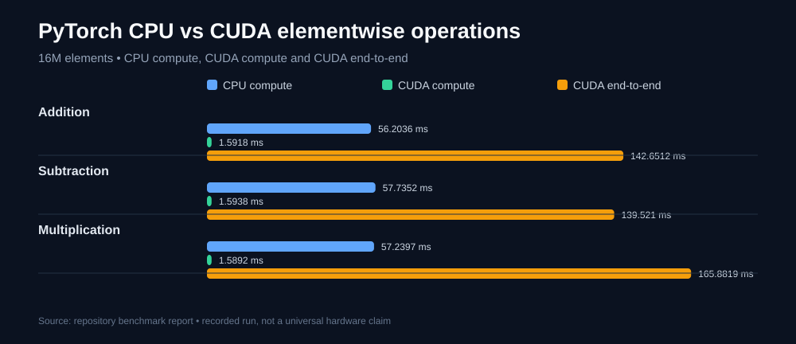

# MiniTensor — A C++ Mini Tensor Library

A lightweight, reusable multidimensional tensor library developed in C++17, focusing on efficient memory management, mathematical operations, CPU performance optimization, and tensor computation.

**Project:** Diwali 2026 Challenge  
**Team Leader:** MANMEET SINGH MANCHANDA  
**Team Size:** 4  
**Development Period:** November 2026  
**Release:** v0.1.0 — Initial Release

[GitHub Repository](https://github.com/manmeetmanchanda10016/Diwali-Project)

---

## 1. Project Overview

MiniTensor is a custom C++ tensor library designed to create, store, access, and manipulate multidimensional numerical data.

The library implements fundamental tensor operations and incorporates CPU optimization techniques such as:

- Contiguous memory allocation.
- 64-byte aligned storage.
- SIMD vectorization.
- OpenMP parallel execution.
- Cache blocking.
- Hybrid matrix multiplication.
- Efficient multidimensional indexing.
- Shape and stride management.

The project progressed through seven development phases, from basic tensor representation to advanced operations, performance optimization, testing, and CMake packaging.

An additional GPU experiment was conducted using PyTorch and an NVIDIA Tesla T4 GPU in Google Colab to study CUDA acceleration.

**Important:** MiniTensor currently supports CPU execution. CUDA/GPU execution is not implemented in the library. The Tesla T4 experiment was conducted separately using PyTorch.

---

## 2. Features

### Tensor Representation and Memory Management

- Multidimensional tensor representation.
- Shape and dimension management.
- Contiguous memory storage.
- Custom 64-byte aligned memory allocation.
- Deep copy and move semantics.
- Memory management and overflow checks.
- Scalar and zero-sized tensor handling.

### Indexing and Reshaping

- Row-major memory layout.
- Precomputed strides.
- Flat indexing using `flat_at()`.
- Multidimensional indexing using `at()`.
- Tensor reshaping without copying tensor elements for compatible shapes.

### Mathematical Operations

- Elementwise addition.
- Elementwise subtraction.
- Elementwise multiplication.
- Matrix multiplication.
- Parallel matrix multiplication using OpenMP.

### Advanced Operations

- Matrix transpose.
- Broadcasting.
- Broadcasting addition, subtraction, and multiplication.
- Sum reduction.
- Mean reduction.
- Minimum reduction.
- Maximum reduction.

### Performance Optimization

- SIMD-based elementwise operations.
- OpenMP parallel execution.
- Parallel SIMD execution.
- Blocked matrix multiplication.
- Parallel blocked matrix multiplication.
- Hybrid matrix multiplication.
- Blocked transpose.
- Link-Time Optimization (LTO).
- Optional native CPU optimization.

### Testing and Packaging

- Six independent test suites.
- Example applications.
- Interactive tensor playground.
- Performance benchmark programs.
- CMake installation and exported targets.
- Installable package configuration.

---

## 3. Project Structure

```text
MiniTensor/
│
├── include/
│   └── minitensor/
│       ├── Shape.h
│       ├── Storage.h
│       ├── Tensor.h
│       └── Ops.h
│
├── src/
│   ├── Shape.cpp
│   ├── Storage.cpp
│   ├── Tensor.cpp
│   └── Ops.cpp
│
├── tests/
│   ├── test_phase1.cpp
│   ├── test_phase2.cpp
│   ├── test_phase3.cpp
│   ├── test_phase4.cpp
│   ├── test_phase5.cpp
│   └── test_phase6.cpp
│
├── benchmarks/
│   ├── benchmark_phase1.cpp
│   ├── benchmark_v2.cpp
│   ├── benchmark_matmul.cpp
│   ├── benchmark_elementwise.cpp
│   ├── benchmark_transpose.cpp
│   ├── benchmark_broadcast.cpp
│   ├── benchmark_broadcast_v2.cpp
│   ├── benchmark_broadcast_v3.cpp
│   ├── benchmark_memory.cpp
│   └── benchmark_remaining.cpp
│
├── examples/
│   ├── main.cpp
│   └── tensor_application.cpp
│
├── cmake/
│   └── MiniTensorConfig.cmake.in
│
├── docs/
│   └── benchmark-visuals/
│       ├── matmul.svg
│       ├── elementwise.svg
│       ├── transpose.svg
│       ├── pytorch-cuda-matmul.svg
│       └── pytorch-cuda-elementwise.svg
│
├── results/                         # Earlier development benchmark logs
│   ├── matmul_benchmark.csv
│   ├── memory_benchmark.csv
│   ├── elementwise_results.txt
│   ├── transpose_results.txt
│   ├── broadcast_results.txt
│   ├── broadcast_v2_results.txt
│   ├── broadcast_v3_results.txt
│   ├── remaining_results.txt
│   ├── system_info.txt
│   └── gpu/
│
├── submission/
│   └── benchmark_results/            # Final 2026 benchmark submission archive
│
├── CMakeLists.txt
├── README.md
├── BENCHMARK_REPORT.md
├── OPTIMIZATIONS.md
├── LICENSE
└── .gitignore
```

---

## 4. Development Phases

### Phase 1 — Tensor Representation and Memory Management

- Shape class for storing tensor dimensions.
- Cached element count.
- Storage class for contiguous memory allocation.
- 64-byte aligned memory allocation.
- Tensor class combining shape and storage.
- Deep copy and move semantics.
- Scalar and empty tensor handling.
- Overflow detection.

### Phase 2 — Indexing and Reshaping

- Row-major stride calculation.
- Multidimensional indexing.
- Flat indexing.
- `at()` and `flat_at()` access methods.
- Tensor reshaping.

### Phase 3 — Mathematical Operations

- Elementwise addition.
- Elementwise subtraction.
- Elementwise multiplication.
- Matrix multiplication.
- OpenMP parallel matrix multiplication.
- Hybrid matrix multiplication.

### Phase 4 — Advanced Tensor Operations

- Matrix transpose.
- Broadcasting.
- Broadcasting arithmetic operations.
- Sum and mean reductions.
- Minimum and maximum reductions.
- Empty tensor reduction handling.

### Phase 5 — Performance Optimization

- Blocked matrix multiplication.
- Parallel blocked matrix multiplication.
- SIMD elementwise operations.
- OpenMP SIMD.
- Blocked transpose.
- Hybrid execution.
- Native CPU optimization.
- Link-Time Optimization.

### Phase 6 — Testing and Application

- Six independent test suites.
- Tensor examples.
- Interactive tensor playground.
- Benchmark programs for different operations.
- Correctness verification.

### Phase 7 — Packaging and Documentation

- CMake installation rules.
- Exported CMake library target.
- Package configuration.
- README documentation.
- MIT License.
- GitHub repository and v0.1.0 release.

---

## 5. Technologies Used

| Technology | Purpose |
|---|---|
| C++17 | Core library implementation |
| CMake | Build system and packaging |
| GCC | C++ compilation |
| OpenMP | CPU parallel execution |
| SIMD | Vectorized CPU operations |
| Git | Version control |
| GitHub | Project hosting |
| Google Colab | Additional benchmarking environment |
| PyTorch | External tensor library comparison |
| CUDA | Separate GPU experiment through PyTorch |

---

## 6. Performance Benchmarks

Performance was evaluated using separate benchmark runs on the developer's laptop and Google Colab.

The results are reported separately because hardware, compiler versions, CPU allocation, and build configurations differ.

### Benchmark Results at a Glance

The following charts summarize selected measurements from the recorded runs. Lower execution time is better. These are environment-specific observations, not guaranteed speedups on other hardware.

**MiniTensor — matrix multiplication**



**MiniTensor — elementwise operations**



**MiniTensor — blocked transpose**



**Separate PyTorch experiment — CPU vs CUDA matrix multiplication**



**Separate PyTorch experiment — CPU vs CUDA elementwise operations**



> The PyTorch/CUDA charts are a separate reference experiment on a Tesla T4. They do not indicate CUDA support in MiniTensor. For detailed methodology, exact values, and limitations, see [BENCHMARK_REPORT.md](BENCHMARK_REPORT.md).

### 6.1 Google Colab Environment

The latest verified MiniTensor benchmark environment:

| Configuration | Details |
|---|---|
| Operating System | Ubuntu 24.04.4 LTS |
| CPU | Intel Xeon @ 2.00 GHz |
| Visible logical CPUs | 2 |
| Compiler | GCC 13.3.0 |
| C++ Standard | C++17 |
| CMake | 3.31.10 |
| OpenMP | 4.5 |
| Optimization | `-O3 -DNDEBUG` |
| Link-Time Optimization | Enabled |
| Native CPU Optimization | Disabled |

The Colab runtime exposed two logical CPUs. Therefore, higher thread counts should be interpreted in the context of this limited CPU allocation.

### 6.2 Matrix Multiplication

Selected results from the latest verified benchmark:

| Matrix Size | Normal Sequential | Best Configuration | Best Median |
|---|---:|---|---:|
| 256 × 256 | 5.832 ms | Hybrid | 5.688 ms |
| 512 × 512 | 48.556 ms | Hybrid, 2 threads | 44.745 ms |
| 1024 × 1024 | 443.092 ms | OpenMP, 2 threads | 371.805 ms |

For the 1024 × 1024 matrix multiplication workload, the best tested configuration achieved approximately **16.1% lower execution time** than normal sequential multiplication.

All 29 tested configurations passed correctness validation.

The parallel-blocked implementation was also evaluated, but it did not consistently outperform the best sequential, OpenMP, or hybrid variants.

### 6.3 Elementwise Operations

Selected results from the MiniTensor elementwise benchmark:

| Tensor Size | Operation | Scalar (ms) | SIMD (ms) | Best Tested (ms) |
|---|---|---:|---:|---:|
| 1M | Addition | 1.465 | 1.347 | 1.287 |
| 1M | Subtraction | 1.418 | 1.401 | 1.291 |
| 1M | Multiplication | 1.348 | 1.387 | 1.296 |
| 4M | Addition | 8.459 | 8.832 | 7.870 |
| 16M | Addition | 89.104 | 87.681 | 85.451 |
| 16M | Multiplication | 86.841 | 87.248 | 82.348 |

The results demonstrate that SIMD and OpenMP improvements depend on workload size, operation type, memory bandwidth, and thread overhead.

They do not guarantee a speedup for every operation.

### 6.4 Blocked Transpose

The transpose benchmark evaluates cache-blocked implementations using different tile sizes.

| Matrix Size | Normal (ms) | Best Block Size | Blocked Time (ms) | Speedup |
|---|---:|---:|---:|---:|
| 256 × 256 | 0.1964 | 16 | 0.1190 | 1.65× |
| 512 × 512 | 1.2918 | 32 | 0.8772 | 1.47× |
| 1024 × 1024 | 5.3929 | 32 | 3.7340 | 1.44× |
| 2048 × 2048 | 66.9556 | 32 | 30.9378 | 2.16× |

The results show that cache blocking can improve transpose performance, particularly for larger matrices.

### 6.5 Broadcasting

The project includes multiple broadcasting benchmark experiments.

The results vary depending on tensor shape and indexing strategy.

Higher-dimensional cases showed improvements in some optimized variants, while simpler cases experienced slowdowns.

The third benchmark version uses matched inputs, allocation, and timing methodology to provide a more controlled comparison.

No universal broadcasting speedup is claimed.

### 6.6 Memory Management

The memory benchmark separates raw allocation, initialization, and tensor construction.

Selected measurements:

| Elements | Raw Allocation | Raw Allocation + Initialization | Storage | Tensor |
|---|---:|---:|---:|---:|
| 262,144 | 0.083 µs | 87.293 µs | 87.249 µs | 87.441 µs |
| 1,048,576 | 0.084 µs | 378.721 µs | 469.078 µs | 435.976 µs |

These measurements help distinguish allocator overhead from the cost of initializing and managing tensor storage.

### 6.7 Additional Operations

Selected measurements from the remaining operations benchmark:

| Operation | Input | Execution Time |
|---|---|---:|
| Tensor construction | 1M elements | 0.3918 ms |
| Flat indexing | 262,144 accesses | 0.3340 ms |
| Multidimensional indexing | 262,144 accesses | 5.5587 ms |
| Two reshape changes | 262,144 elements | 0.0002 ms |
| Fill | 1M elements | 0.4426 ms |
| Sum | 1M elements | 0.6347 ms |
| Mean | 1M elements | 0.6349 ms |
| Minimum | 1M elements | 1.2752 ms |
| Maximum | 1M elements | 1.2698 ms |

These values represent measurements from the supplied Colab benchmark run.

---

## 7. CUDA Experiment — PyTorch CPU vs NVIDIA Tesla T4

An additional GPU experiment was conducted using PyTorch to study CPU-versus-GPU execution.

**Environment:**

| Configuration | Details |
|---|---|
| GPU | NVIDIA Tesla T4 |
| PyTorch | 2.11.0+cu130 |
| CUDA | 13.0 |
| CPU threads | 2 |
| Data type | Float64 |

This is a separate experiment. MiniTensor itself does not currently implement CUDA.

### 7.1 Matrix Multiplication

Selected results from the final controlled experiment:

| Matrix Size | PyTorch CPU (ms) | CUDA Compute (ms) | CUDA End-to-End (ms) |
|---|---:|---:|---:|
| 64 × 64 | 0.0152 | 0.2687 | 0.3705 |
| 128 × 128 | 0.0769 | 0.2740 | 0.4755 |
| 256 × 256 | 0.5302 | 0.5207 | 1.0654 |
| 512 × 512 | 3.9840 | 3.7812 | 5.5136 |
| 1024 × 1024 | 63.0601 | 13.9156 | 15.9228 |

For 1024 × 1024 matrix multiplication, CUDA achieved approximately **4.53× compute-only speedup** over the PyTorch CPU measurement.

### 7.2 Elementwise Operations

Selected measurements:

| Tensor Size | Operation | CPU (ms) | CUDA Compute (ms) | CUDA End-to-End (ms) |
|---|---|---:|---:|---:|
| 1M | Addition | 1.0861 | 0.1173 | 5.1228 |
| 1M | Subtraction | 1.1592 | 0.1260 | 6.0450 |
| 1M | Multiplication | 4.0036 | 0.1238 | 5.1269 |
| 16M | Addition | 56.2036 | 1.5918 | 142.6512 |
| 16M | Subtraction | 57.7352 | 1.5938 | 139.5210 |
| 16M | Multiplication | 57.2397 | 1.5892 | 165.8820 |

### 7.3 CUDA Experiment Findings

- CUDA compute-only performance improved substantially for large workloads.
- Small matrix operations did not benefit from GPU execution because of launch and execution overhead.
- Data transfer overhead significantly affected end-to-end elementwise performance.
- CUDA end-to-end execution was slower than CPU execution for all elementwise cases shown.
- CUDA was faster end-to-end for the 1024 × 1024 matrix multiplication case.

**Important:** These results describe PyTorch CPU-versus-CUDA performance. They do not represent MiniTensor GPU performance.

---

## 8. Benchmarking Methodology

The project includes separate benchmark programs for:

- Tensor construction and memory allocation.
- Indexing and reshaping.
- Matrix multiplication.
- Elementwise operations.
- Broadcasting.
- Matrix transpose.
- Reduction operations.

The C++ matrix multiplication and memory benchmarks use:

- 3 warm-up runs.
- 10 measured runs.
- Average execution time.
- Median execution time.
- CSV result generation.

Other MiniTensor benchmark programs report measurements through their respective console logs and should be interpreted according to their individual timing implementations.

The PyTorch GPU experiment separates:

**Compute-only measurement:** Inputs are already present on the GPU and only computation is measured.

**End-to-end measurement:** Includes CPU-to-GPU transfers, computation, and GPU-to-CPU result transfer.

These measurements represent different workloads and should not be treated as equivalent.

---

## 9. Testing and Validation

MiniTensor includes six independent test suites.

| Test Suite | Status |
|---|---|
| Phase 1 — Tensor Representation | Passed |
| Phase 2 — Indexing | Passed |
| Phase 3 — Mathematical Operations | Passed |
| Phase 4 — Advanced Operations | Passed |
| Phase 5 — Optimization | Passed |
| Phase 6 — Testing/Application | Passed |

**Total: 6/6 test suites passed.**

The latest fresh Linux build audit also confirmed that benchmark and example executables compiled successfully.

An independent CMake package consumer test successfully located and linked the installed MiniTensor library using:

```cmake
find_package(MiniTensor REQUIRED)
```

The exported target is:

```cmake
MiniTensor::minitensor
```

---

## 10. Building the Project

### Requirements

- C++ compiler with C++17 support.
- CMake.
- OpenMP support.
- GCC or Clang recommended.

### Build on Windows (MSYS2 MinGW)

Configure the Release build:

```powershell
cmake -S . -B build-release -G "MinGW Makefiles" -DCMAKE_BUILD_TYPE=Release -DMINITENSOR_ENABLE_NATIVE=ON -DMINITENSOR_ENABLE_LTO=ON
```

Build:

```powershell
cmake --build build-release -j
```

Run tests:

```powershell
ctest --test-dir build-release --output-on-failure
```

Install:

```powershell
cmake --install build-release --prefix install
```

### Build on Linux

Configure:

```bash
cmake -S . -B build -DCMAKE_BUILD_TYPE=Release
```

Build:

```bash
cmake --build build -j
```

Run tests:

```bash
ctest --test-dir build --output-on-failure
```

---

## 11. CMake Packaging

MiniTensor supports installation and package export through CMake.

The exported library target is:

```cmake
MiniTensor::minitensor
```

A separate consumer project can locate the installed package using:

```cmake
find_package(MiniTensor REQUIRED)
```

The package configuration also declares its OpenMP dependency.

---

## 12. Optimization Documentation

Detailed implementation and optimization notes are available in:

- `OPTIMIZATIONS.md` — memory management, SIMD, OpenMP, matrix multiplication, transpose, broadcasting, reductions, and future optimization opportunities.
- `BENCHMARK_REPORT.md` — benchmark methodology, environment details, measured results, and limitations.
- `results/` — raw benchmark outputs and CSV files.
- [`submission/benchmark_results/`](submission/benchmark_results/) — final 2026 benchmark archive, including the consolidated execution-time CSV and categorized raw outputs.
- [`docs/benchmark-visuals/`](docs/benchmark-visuals/) — SVG charts embedded above.

These documents provide additional technical detail beyond this README.

---

## 13. Limitations and Future Improvements

### Current Limitations

- CUDA/GPU execution is not implemented in MiniTensor.
- OpenMP is currently required by the configured build and package.
- Performance depends on compiler optimizations and hardware characteristics.
- Benchmark results vary across execution environments.
- The final competition evaluation protocol has not yet been applied.

### Future Improvements

- Optimize matrix multiplication and cache blocking.
- Improve SIMD vectorization.
- Optimize broadcasting and reduction operations.
- Reduce unnecessary memory allocations and copies.
- Introduce tensor views and slicing.
- Investigate optional CUDA support.
- Improve parallel execution and thread scaling.
- Expand edge-case and randomized correctness tests.
- Evaluate performance using the professor's common benchmark protocol.

---

## 14. Competition Benchmarking Status

The current benchmark measurements are preliminary development results.

The final competition evaluation should follow the professor's common benchmark protocol, including identical test cases and input dimensions for all teams.

Final performance claims should be based on:

- The specified Ubuntu environment.
- The required compiler and optimization flags.
- The official benchmark inputs.
- The prescribed warm-up and measurement procedure.
- Average and median execution times.
- Separate allocation and deallocation measurements.
- GFLOPS for matrix multiplication.

The current Colab results should not be presented as official competition results until this protocol is applied.

---

## 15. Project Information

**Project:** MiniTensor — C++ Mini Tensor Library  
**Challenge:** Diwali 2026 Challenge  
**Team Leader:** MANMEET SINGH MANCHANDA  
**Team Size:** 4  
**Release:** v0.1.0 — Initial Release

**GitHub Repository:**

https://github.com/manmeetmanchanda10016/Diwali-Project

**License:** MIT License